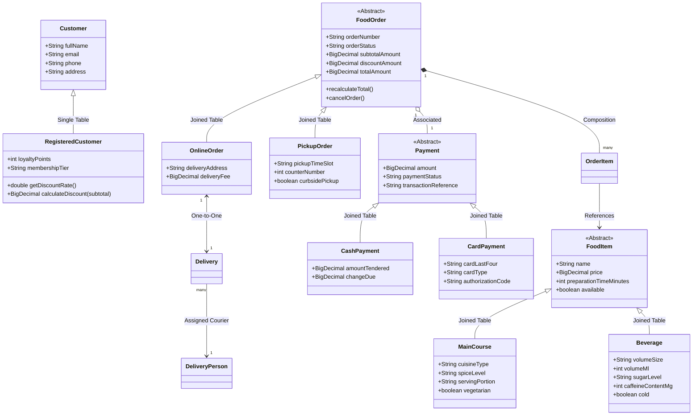

# 🇱🇰 Online Food Delivery Management System
### A Spring Boot Full-Stack Application | Sri Lankan Edition

A full-stack food delivery management application developed using **Spring Boot 3, Java, Spring Data JPA, Hibernate, and Thymeleaf**. Designed for IntelliJ IDEA with a clean Light Theme interface and Sri Lankan Rupee (LKR) currency support.

---

## 01. Application Overview

| Configuration | Details |
|---|---|
| Application Type | Full-Stack Web Application |
| Framework | Spring Boot 3.2.4 |
| Programming Language | Java 17 / 21 |
| Persistence Layer | Spring Data JPA |
| ORM | Hibernate 6 |
| Frontend | HTML5, Thymeleaf, Vanilla CSS |
| Database | H2 In-Memory Database |
| Default Port | `8080` |
| Currency | Sri Lankan Rupee (LKR) |
| IDE | IntelliJ IDEA |

### User Interface Design

The application follows a modern, minimal Light Theme design system.

- **Page Background:** Light Slate (`#F8FAFC`)
- **Content Surfaces:** White (`#FFFFFF`)
- **Border Color:** Slate (`#E2E8F0`)
- **Primary Color:** Electric Blue (`#2563EB`)
- **Hover Color:** Dark Blue (`#1D4ED8`)
- **Typography:** Inter / system-ui
- **Text Color:** Dark Slate (`#0F172A`)

### Currency and Regional Formatting

All financial calculations and displayed prices are configured for Sri Lankan Rupees.

- Currency: `LKR`
- Display format: `LKR #,##0.00`
- Formatting utility: `CurrencyUtil.java`
- Location: `src/main/java/com/fooddelivery/common/util/CurrencyUtil.java`

---

## 02. Application Navigation

The application is accessible locally through port `8080`.

For additional information about application links, refer to [PORT_AND_LINKS.md](PORT_AND_LINKS.md).

| Application Feature | Endpoint | Purpose |
|---|---|---|
| Main Dashboard | [Open Dashboard](http://localhost:8080/) | Overview and LKR metrics |
| Food Menu | [View Foods](http://localhost:8080/foods) | Menu catalog and item stock |
| Add Food | [Create Food Item](http://localhost:8080/foods/new) | Add MainCourse or Beverage |
| Customer Directory | [View Customers](http://localhost:8080/customers) | Customer records and loyalty tiers |
| Customer Registration | [Register Customer](http://localhost:8080/customers/new) | Guest and member registration |
| Order History | [View Orders](http://localhost:8080/orders) | Active and completed orders |
| Order Checkout | [Place Order](http://localhost:8080/orders/new) | Online delivery and counter pickup |
| Delivery Management | [View Deliveries](http://localhost:8080/deliveries) | Courier fleet and delivery tracking |
| Courier Assignment | [Assign Courier](http://localhost:8080/deliveries/new) | Assign a rider to an online order |
| Payment Settlement | [Payment Details](http://localhost:8080/payments/1) | Cash change and card validation |
| Database Browser | [H2 Console](http://localhost:8080/h2-console) | Access the in-memory database |

---

## 03. System Architecture and OOP Design

The application is organized into four functional components. Object-oriented programming principles are implemented through inheritance, polymorphism, encapsulation, and object associations.

### Domain Class Structure

The following diagram represents the application's main domain hierarchy and relationships.



### Persistence and Inheritance Strategies

| Domain Hierarchy | Inheritance Strategy |
|---|---|
| FoodItem → MainCourse, Beverage | Joined Table |
| Customer → RegisteredCustomer | Single Table |
| FoodOrder → OnlineOrder, PickupOrder | Joined Table |
| Payment → CashPayment, CardPayment | Joined Table |

---

## 04. Functional Components

The system is divided into four main modules, each responsible for a specific area of food delivery operations.

### Component 01 — Food Menu Management

**Purpose:** Manage the food catalog and available menu items.

**Class hierarchy:**
- `FoodItem` — Abstract base class.
- `MainCourse` — Represents main food dishes.
- `Beverage` — Represents drinks and beverages.

**MainCourse attributes:**
- `cuisineType`
- `spiceLevel`
- `servingPortion`
- `vegetarian`

**Beverage attributes:**
- `volumeSize`
- `volumeMl`
- `sugarLevel`
- `caffeineContentMg`
- `cold`

**Available operations:**
- Display the food catalog.
- Add new food items.
- Edit existing items.
- Delete food items.

**Application routes:**

| Operation | Route |
|---|---|
| Catalog | `/foods` |
| Add Item | `/foods/new` |
| Edit Item | `/foods/edit/{id}` |
| Delete Item | `/foods/delete/{id}` |

### Component 02 — Customer Management

**Purpose:** Maintain customer information and membership-related benefits.

**Class hierarchy:**
- `Customer` — Represents a guest customer.
- `RegisteredCustomer` — Extends Customer with membership information.

**Registered customer features:**
- Loyalty point management.
- Membership tier management.
- Dynamic discount calculations.

**Membership discount structure:**

| Membership Tier | Discount |
|---|---:|
| Platinum | 15% |
| Gold | 10% |
| Silver | 5% |
| Bronze | 0% |

**Available operations:**
- View customer directory.
- Register customers.
- Edit customer profiles.
- Delete customer records.

**Application routes:**

| Operation | Route |
|---|---|
| Directory | `/customers` |
| Register | `/customers/new` |
| Edit Profile | `/customers/edit/{id}` |
| Delete | `/customers/delete/{id}` |

### Component 03 — Food Order Management

**Purpose:** Handle food ordering, checkout, order calculations, and order status management.

**Class hierarchy:**
- `FoodOrder` — Abstract base order class.
- `OnlineOrder` — Represents delivery orders.
- `PickupOrder` — Represents counter pickup orders.

**OnlineOrder features:**
- Delivery address.
- Standard delivery fee of LKR 350.00.

**PickupOrder features:**
- Pickup time slot.
- Counter number.
- Curbside pickup option.

**Financial calculation features:**
- Automatic order line subtotal calculations.
- Loyalty discount calculations.
- Fulfillment fee calculations.
- Automatic net total calculation.

**Available operations:**
- Place new food orders.
- View order records.
- Search and manage orders.
- Update order status.
- Cancel orders.

**Application routes:**

| Operation | Route |
|---|---|
| Checkout | `/orders/new` |
| Order Logs | `/orders` |
| Status Management | `/orders/edit/{id}` |
| Cancellation | `/orders/{id}/cancel` |

### Component 04 — Delivery and Payment Management

**Purpose:** Coordinate delivery assignments and manage payment transactions.

**Delivery relationships:**
- OneToOne relationship between `OnlineOrder` and `Delivery`.
- ManyToOne relationship between `Delivery` and `DeliveryPerson`.

**Payment class hierarchy:**
- `Payment` — Abstract payment base class.
- `CashPayment` — Handles cash transactions.
- `CardPayment` — Handles card transactions.

**Cash payment features:**
- Amount tendered.
- Change due calculation.

**Card payment features:**
- Last four card digits.
- Card type.
- Authorization code.

**Available operations:**
- View the delivery dispatch board.
- Assign couriers.
- Manage delivery assignments.
- Track deliveries.
- Settle payments.

**Application routes:**

| Operation | Route |
|---|---|
| Dispatch Board | `/deliveries` |
| Assign Courier | `/deliveries/new` |
| Assign Existing Delivery | `/deliveries/assign/{id}` |
| Settle Payment | `/payments/{orderId}` |

---

## 05. Installation and Execution Guide

Follow these instructions to open and run the project using IntelliJ IDEA.

### Requirements

Before opening the application, make sure the following software is available:

- IntelliJ IDEA
- JDK 17 or JDK 21
- Apache Maven
- Spring Boot 3.2.4 compatible environment

### Step 1 — Import the Project

1. Launch IntelliJ IDEA.
2. Select **File → Open**.
3. Select the project directory: `c:\Online Food Delivery Management System`.
4. Allow IntelliJ IDEA to recognize and import the Maven project.
5. Wait for Maven dependencies to finish downloading.

### Step 2 — Configure the Java SDK

1. Open **File → Project Structure**.
2. Select **Project**.
3. Set the Project SDK to JDK 17 or JDK 21.
4. Apply the changes.

### Step 3 — Start the Application

Locate the main Spring Boot application class:

`src/main/java/com/fooddelivery/FoodDeliveryApplication.java`

Click the green **Run** icon next to the main method or use:

`Shift + F10`

Alternatively, start the application through the terminal:

```powershell
mvn spring-boot:run
```

Once the application starts successfully, it will be available on port `8080`.

### Step 4 — Open the Application

| Feature | Local URL |
|---|---|
| Main Dashboard | http://localhost:8080/ |
| Food Menu Catalog | http://localhost:8080/foods |
| Add Dish / Beverage | http://localhost:8080/foods/new |
| Customer Directory | http://localhost:8080/customers |
| Register Customer | http://localhost:8080/customers/new |
| Order Logs | http://localhost:8080/orders |
| Place Food Order | http://localhost:8080/orders/new |
| Delivery Dispatch Board | http://localhost:8080/deliveries |
| Assign Courier | http://localhost:8080/deliveries/new |
| H2 Database Console | http://localhost:8080/h2-console |

---

## 06. Database Access

The application provides an H2 in-memory relational database console for browsing database information.

**H2 Console:** http://localhost:8080/h2-console

Use the following connection details:

| Setting | Value |
|---|---|
| JDBC URL | `jdbc:h2:mem:fooddeliverydb` |
| Username | `sa` |
| Password | `password` |

---

## 07. Database Scripts and Automated Seeding

