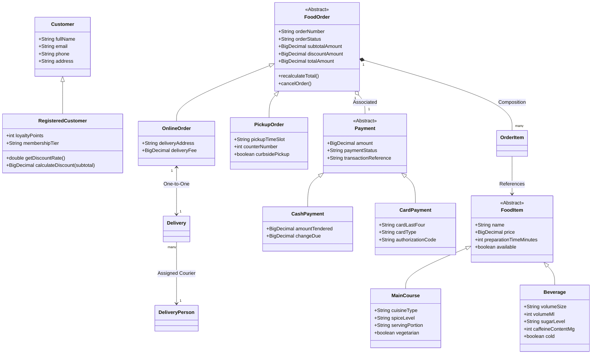

🇱🇰 Online Food Delivery Management System
A Spring Boot Full-Stack Application | Sri Lankan Edition
A full-stack food delivery management application developed using Spring Boot 3.3.4, Java 21, JSON file handling, and Thymeleaf. Designed for IntelliJ IDEA with a clean Light Theme interface and Sri Lankan Rupee (LKR) currency support. Orders, customers, menu items, deliveries, and payments are stored in data/food-delivery-data.json.
01. Application Overview
Configuration	Details
Application Type	Full-Stack Web Application
Framework	Spring Boot 3.3.4
Programming Language	Java 21
Persistence Layer	JSON file handling with Jackson
Data file	data/food-delivery-data.json
Frontend	HTML5, Thymeleaf, Vanilla CSS
Default Port	8080
Currency	Sri Lankan Rupee (LKR)
IDE	IntelliJ IDEA

User Interface Design
The application follows a modern, minimal Light Theme design system.
- Page Background: Light Slate (#F8FAFC)
- Content Surfaces: White (#FFFFFF)
- Border Color: Slate (#E2E8F0)
- Primary Color: Electric Blue (#2563EB)
- Hover Color: Dark Blue (#1D4ED8)
- Typography: Inter / system-ui
- Text Color: Dark Slate (#0F172A)
Currency and Regional Formatting
All financial calculations and displayed prices are configured for Sri Lankan Rupees.
- Currency: LKR
- Display format: LKR #,##0.00
- Formatting utility: CurrencyUtil.java
- Location: src/main/java/com/fooddelivery/common/util/CurrencyUtil.java
02. Application Navigation
The application is accessible locally through port 8080.

For additional information about application links, refer to [PORT_AND_LINKS.md](PORT_AND_LINKS.md).
Application Feature	Endpoint	Purpose
Main Dashboard	Open Dashboard	Overview and LKR metrics
Food Menu	View Foods	Menu catalog and item stock
Add Food	Create Food Item	Add MainCourse or Beverage
Customer Directory	View Customers	Customer records and loyalty tiers
Customer Registration	Register Customer	Guest and member registration
Order History	View Orders	Active and completed orders
Order Checkout	Place Order	Online delivery and counter pickup
Delivery Management	View Deliveries	Courier fleet and delivery tracking
Courier Assignment	Assign Courier	Assign a rider to an online order
Courier Fleet	Manage Couriers	Create, view, update, and delete a courier
Payment Settlement	Payment Details	Cash or card settlement, status update, refund, and saved method

03. System Architecture and OOP Design
The application is organized into four functional components. Object-oriented programming principles are implemented through inheritance, polymorphism, encapsulation, and object associations.
Domain Class Structure
The following diagram represents the application's main domain hierarchy and relationships.

Persistence and inheritance
Domain objects stay as Java classes. The JSON file stores a type field and related record IDs. When the file is read, the correct subclass is created again.
Domain hierarchy	JSON type values
FoodItem → MainCourse, Beverage	MAIN_COURSE, BEVERAGE
Customer → RegisteredCustomer	GUEST, REGISTERED
FoodOrder → OnlineOrder, PickupOrder	ONLINE, PICKUP
Payment → CashPayment, CardPayment	CASH, CARD

Relationships are stored as IDs: an order stores customerId, each line stores foodItemId, an online order stores deliveryId, a delivery stores deliveryPersonId, and a payment stores orderId.
Thymeleaf UI → Controller → Service → Repository → DataStoreManager → data/food-delivery-data.json
FileDataStore writes to a temporary file, checks that the temporary file can be read, copies the current file to data/food-delivery-data.json.bak and data/backups/, then moves the temporary file into place. A corrupt primary file is restored from the backup. It is not replaced with an empty file. Sample records are inserted only when the food list is empty.
04. Functional Components
The system is divided into four main modules, each responsible for a specific area of food delivery operations.
Component 01 — Food Menu Management
Purpose: Manage the food catalog and available menu items.

Class hierarchy:
- FoodItem — Abstract base class.
- MainCourse — Represents main food dishes.
- Beverage — Represents drinks and beverages.
MainCourse attributes:
- cuisineType
- spiceLevel
- servingPortion
- vegetarian
Beverage attributes:
- volumeSize
- volumeMl
- sugarLevel
- caffeineContentMg
- cold
Available operations:
- Display the food catalog.
- Add new food items.
- Edit existing items.
- Delete food items.
Application routes:
Operation	Route
Catalog	/foods
Add Item	/foods/new
Edit Item	/foods/edit/{id}
Delete Item	/foods/delete/{id}

Component 02 — Customer Management
Purpose: Maintain customer information and membership-related benefits.

Class hierarchy:
- Customer — Represents a guest customer.
- RegisteredCustomer — Extends Customer with membership information.
Registered customer features:
- Loyalty point management.
- Membership tier management.
- Dynamic discount calculations.
Membership discount structure:
Membership Tier	Discount
Platinum	15%
Gold	10%
Silver	5%
Bronze	0%

Available operations:
- View customer directory.
- Register customers.
- Edit customer profiles.
- Delete customer records.
Application routes:
Operation	Route
Directory	/customers
Register	/customers/new
Edit Profile	/customers/edit/{id}
Delete	/customers/delete/{id}

Component 03 — Food Order Management
Purpose: Handle food ordering, checkout, order calculations, and order status management.

Class hierarchy:
- FoodOrder — Abstract base order class.
- OnlineOrder — Represents delivery orders.
- PickupOrder — Represents counter pickup orders.
OnlineOrder features:
- Delivery address.
- Standard delivery fee of LKR 350.00.
PickupOrder features:
- Pickup time slot.
- Counter number.
- Curbside pickup option.
Financial calculation features:
- Automatic order line subtotal calculations.
- Loyalty discount calculations.
- Fulfillment fee calculations.
- Automatic net total calculation.
Available operations:
- Place new food orders.
- View order records.
- Search and manage orders.
- Update order status.
- Cancel orders.
Four Order Management CRUD sets in OrderService:
Set	Create	Read	Update	Delete
Online orders	createOnlineOrder	getOnlineOrderById	updateOnlineOrder	cancelOnlineOrder keeps the record as CANCELLED
Pickup orders	createPickupOrder	getPickupOrderById	updatePickupOrder	cancelPickupOrder keeps the record as CANCELLED
Order items	addOrderItem	getOrderItems	updateOrderItemQuantity	removeOrderItem
Admin orders	createAdminOrder	getAllOrders and searchOrders	updateOrderStatus	deleteInvalidOrder archives an unpaid pending order

Customers can change an order only while it is PENDING. Cancellation keeps the record with status CANCELLED. An archived order leaves the active list; paid and in-progress orders stay there.

Application routes:
Operation	Route
Checkout	/orders/new
Order logs, search, and filters	/orders
Customer order details, items, and edits	/orders/my-orders/{id}
Review on any order	/orders/my-orders/{id}/review
Status management	/orders/edit/{id}
Archive an unpaid pending order	/orders/edit/{id}/archive
Cancellation	/orders/{id}/cancel

Component 04 — Delivery and Payment Management
Purpose: Coordinate delivery assignments and manage payment transactions.

Delivery relationships:
- OneToOne relationship between OnlineOrder and Delivery.
- ManyToOne relationship between Delivery and DeliveryPerson.
Payment class hierarchy:
- Payment — Abstract payment base class.
- CashPayment — Handles cash transactions.
- CardPayment — Handles card transactions.
Cash payment features:
- Amount tendered.
- Change due calculation.
Card payment features:
- Last four card digits.
- Card type.
- Authorization code.
Available operations:
- View the delivery dispatch board.
- Assign couriers.
- Create, view, update, and delete couriers.
- Manage delivery assignments.
- Track deliveries.
- Settle a payment with cash or card.
- Update a payment status, cash tender, or card authorization code.
- Delete a pending or failed payment.
- Request, update, or delete a refund.
- Save or clear a registered customer's payment method.
Application routes:
Operation	Route
Dispatch Board	/deliveries
Courier Fleet	/deliveries/couriers
Add or Update Courier	/deliveries/couriers/new and /deliveries/couriers/edit/{id}
Assign Courier	/deliveries/new
Assign Existing Delivery	/deliveries/assign/{id}
Settle Payment	/payments/{orderId}
Update Payment	/payments/{orderId}/update
Delete Payment	/payments/{orderId}/delete
Refund	/payments/{orderId}/refunds
Saved Payment Method	/payments/{orderId}/method

05. Installation and Execution Guide
Follow these instructions to open and run the project using IntelliJ IDEA.
Requirements
Before opening the application, make sure the following software is available:
- IntelliJ IDEA
- JDK 21
- Apache Maven
- Spring Boot 3.3.4
Step 1 — Import the Project
1. Launch IntelliJ IDEA.
2. Select File → Open.
3. Select the project directory: c:\Online Food Delivery Management System.
4. Allow IntelliJ IDEA to recognize and import the Maven project.
5. Wait for Maven dependencies to finish downloading.
Step 2 — Configure the Java SDK
1. Open File → Project Structure.
2. Select Project.
3. Set the Project SDK to JDK 21.
4. Apply the changes.
Step 3 — Start the Application
Locate the main Spring Boot application class:

src/main/java/com/fooddelivery/FoodDeliveryApplication.java

Click the green Run icon next to the main method or use:

Shift + F10

Alternatively, start the application through the terminal:
mvn spring-boot:run
Once the application starts successfully, it will be available on port 8080.
Step 4 — Open the Application
Feature	Local URL
Main Dashboard	http://localhost:8080/
Food Menu Catalog	http://localhost:8080/foods
Add Dish / Beverage	http://localhost:8080/foods/new
Customer Directory	http://localhost:8080/customers
Register Customer	http://localhost:8080/customers/new
Order Logs	http://localhost:8080/orders
Place Food Order	http://localhost:8080/orders/new
Delivery Dispatch Board	http://localhost:8080/deliveries
Courier Fleet	http://localhost:8080/deliveries/couriers
Assign Courier	http://localhost:8080/deliveries/new

06. JSON file storage
Application data is stored outside the web root, so it is not served as a static file.
Item	Location
Primary file	data/food-delivery-data.json
Latest backup	data/food-delivery-data.json.bak
Older backups	data/backups/
Directory setting	app.storage.data-directory in application.properties

The file contains customers, foodItems, orders (with nested items), deliveries, deliveryPersons, payments, refunds, archivedOrders, and sequences for the next numeric id. Passwords for the sample accounts are the demo value password123. New registrations store that same demo value in passwordHash, which is how the existing login check works.

The old SQL scripts are kept only as reference under docs/legacy-db/. The running application does not connect to H2, MySQL, PostgreSQL, or SQL Server.
07. Sample data and tests
On startup, DataInitializer calls SampleDataSeeder. The seeder writes the Sri Lankan sample menu, customers, couriers, online orders, pickup orders, deliveries, and payments only when the food list is empty. Restarting the application does not duplicate those records.

mvn test was run after the payment update, delete, refund, and saved-method operations were added: 42 tests, 0 failures. That run covered login, form validation, JSON recovery, the order and delivery operations, and the payment operations.